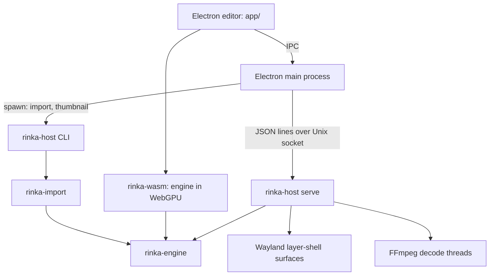

# Architecture



## Crates

| Crate | Role | Platform code |
| --- | --- | --- |
| `rinka-engine` | Project model (`project.rs`), color (`color.rs`), image decoding (`image.rs`), video conversion (`video.rs`), GPU profile and surfaces (`gpu.rs`), renderer (`render.rs`), scenes and effect passes (`scene.rs`), offscreen capture (`capture.rs`) | none |
| `rinka-wasm` | wasm-bindgen wrapper: `Preview` (canvas surface, asset cache, video frames, scenes), `decodeImage`/`decodeImageRaw` for the worker | browser only (`#![cfg(target_arch = "wasm32")]`) |
| `rinka-host` | `serve` (Wayland presenter + control socket), `import`, `thumbnail`, `preview` (winit window), `video-timing`, `info` | Linux: Wayland, FFmpeg |
| `rinka-import` | Wallpaper Engine: `pkg.rs`, `tex.rs`, `preprocess.rs`, `shader.rs`, `value.rs`, `assets.rs`, `convert.rs`, `report.rs` | none |

`app/` is the Electron editor: `src/main` (main process), `src/preload`
(context bridge `window.rinka`), `src/renderer` (Preact UI, preview, decode
worker, WebCodecs player), `src/shared/api.ts` (types shared across processes).

## Project format

A project is a directory with `project.json` and its assets:

```json
{ "format": "rinka.project", "version": 1, "title": "…",
  "content": { "type": "color" | "image" | "video" | "scene", … },
  "provenance": { "source": "wallpaper-engine", "id": "…", "report": "import-report.json", "reference": "reference/preview.gif" } }
```

- `color`: `{color: "#rrggbb"}`.
- `image` / `video`: `{source: "assets/x", fit, background}`; `fit` is
  cover/contain/stretch/center/tile, computed in output pixels (center and
  tile are 1:1 device pixels).
- `scene`: canvas `width`/`height`, `fit`, `clear_color`, `color_space: gamma`,
  `layers` (bottom to top: texture, origin (center, y down), size, scale,
  angle (clockwise, radians), color, alpha, brightness, blend, effects),
  `textures` (path → clamp/nearest), `shaders` (id → WGSL vertex/fragment
  paths, reflected uniform layout, texture slots).
- Asset paths are relative, `/`-separated, validated (`check_asset_path`); the
  host also refuses symlinks leaving the project.
- Unknown fields are rejected (`deny_unknown_fields`). Newer versions error
  with a version message. `wpe.project` is accepted and upgraded on load.

Application configuration (not project content): `~/.config/rinka/config.json`
holds `{version: 1, assignments: {output: projectId}}`; the library is
`~/.config/rinka/projects/<uuid>/`; thumbnails are in
`~/.config/rinka/cache/thumbnails/`.

## Engine rendering

- `Renderer` (per target format): the fullscreen scene pipeline for
  color/image/video, samplers, mip generator (Srgba8, Rgba8Raw,
  LinearPremulF16), placeholders.
- `GpuImage`: uploaded, mipmapped texture. `width/height` are the placement
  size (original image size); `texture_width/height` the actual texels.
  Decoding may downscale (8192 native, 4096 preview) without moving anything.
- `VideoTexture`: Y, U, V `R8Unorm` planes with explicit chroma size
  (4:2:0, 4:2:2, 4:4:4).
- `Target` (per output): uniforms and bind group; `set_project` binds a
  `Source` (image or YUV); `set_scene` attaches a `GpuScene`; `render(&Frame)`.
- `Frame`: `FrameViews { srgb, raw }` of the same texture, render size,
  output size (larger than the target for the scaled-down preview), scene time.
- `SurfaceSetup`: non-sRGB 8-bit storage format with both sRGB and raw view
  formats, opaque alpha when available, Fifo. `draw()` acquires, records via a
  closure, presents, reconfigures once on outdated.
- `GpuScene`: per output. Layers are quads mapped canvas → output (fit) →
  clip. A layer with effects first renders its passes into two ping-pong
  `Rgba8Unorm` buffers (≤4096 px); slot 0 is the previous result. Effect
  uniforms are filled by name from the reflected layout: material values once,
  `g_Time` each frame, `g_TextureNResolution`, identity MVP, centered pointer.

## Host (`rinka-host serve`)

- calloop event loop with the Wayland source, a control channel and a timer.
- Initial roundtrips happen before the socket opens, so requests see outputs.
- One background layer surface per assigned output (anchor all edges,
  exclusive zone −1, no keyboard, empty input region), fractional scale via
  `wp_fractional_scale_v1` + viewporter, integer buffer scale otherwise.
- `prepare()` loads a project and decodes or probes its assets before
  anything changes, so errors reach the client. Images are cached per file
  version (`ImageCache`) and shared across outputs.
- Video: one `Player` per wallpaper (decode thread with a bounded queue). The
  timer wakes at the next due frame; each present requests a frame callback,
  and the next draw waits for it. No callback for 500 ms means hidden: the
  clock pauses.
- Scenes with effects animate at 30 fps (`SCENE_FPS`) through the same timer.
- `--restore [DIR]` reads the editor's `config.json` assignments at start.

## Control protocol (v1)

Newline-delimited JSON on `$XDG_RUNTIME_DIR/rinka/host.sock`. Each request
`{"id", "cmd", …}` gets one response `{"id", "ok", "result" | "error": {code,
message}}`. `hello {protocol: 1}` must come first. Commands: `capabilities`,
`outputs` (names, geometry, transform, assignment, surface and video state),
`assign {output?, project}`, `unassign {output?}`, `reload {project}`,
`pause`, `resume`, `seek {output?, position}`, `shutdown`. Defined in
`crates/rinka-host/src/protocol.rs`.

## Editor

- Main process: library storage (atomic writes, signature sniffing, SHA-256
  dedupe), thumbnails (batched `rinka-host thumbnail`, keyed by content +
  asset stat + host binary + size), host connection (connect or spawn
  detached), workshop scanning and import (`rinka-host import`, up to 3
  concurrent dry runs), the `rinka://app/…` protocol (renderer files,
  `library/<id>/…` with byte ranges, `thumbs/…`, `workshop/<id>/…`).
- Renderer: Preact views: Library (grid/compact/list, filters, sort, search,
  drag-and-drop), Wallpaper (full-window preview, glass bar, display map,
  scene tools, report popover), Import (workshop items, report panel),
  Settings. The open wallpaper is in the URL hash (`#/w/<id>`).
- Preview (`preview.ts`): one canvas and one WebGPU device for the app's
  lifetime. Images decode in a worker. Video plays through WebCodecs
  (`mp4-player.ts`, mp4box sample table) feeding raw planes to the engine;
  `<video>` is the fallback ("Approx. colors"). Scenes fetch textures and WGSL
  and run a 30 fps loop.

## Wallpaper Engine import

1. Classify by `project.json` type.
2. Resolve assets: package (`scene.pkg`), item files, then the effect folder,
   then the install's `assets`.
3. Decode textures to PNG (cropped, GL channel meaning, first sprite frame).
4. Convert objects. Image layers go through model → material
   (`genericimage*`), with parent transforms composed and y flipped. Particles,
   text, sound, models, lights and composition layers are reported
   unsupported.
5. For each effect pass: merge material and scene overrides; combos from
   defaults, material, scene and provided textures; translate (cached by
   shader + combos).
6. Report, then write atomically (temp dir + rename) with
   `import-report.json` and the item's preview as a reference.

Shader translation (`shader.rs`): our C preprocessor (includes once,
conditionals, implicit `common.h`) → declaration rewrite to Vulkan GLSL (fixed
attribute locations, varyings by name with array splitting through a wrapper
`main`, one std140 uniform block shared by both stages, texture/sampler pairs
at `1+2n`/`2+2n`) → HLSL-ism fixes → naga → WGSL plus reflected uniforms.
