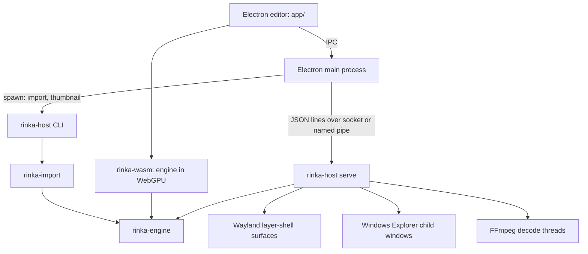

# Architecture



## Crates

| Crate | Role | Platform code |
| --- | --- | --- |
| `rinka-engine` | Project model (`project.rs`), color (`color.rs`), image decoding (`image.rs`), video conversion (`video.rs`), GPU profile and surfaces (`gpu.rs`), renderer (`render.rs`), scenes and effect passes (`scene.rs`), particle format and simulation (`particles.rs`), layer meshes and skinning (`mesh.rs`), offscreen capture (`capture.rs`) | none |
| `rinka-wasm` | wasm-bindgen wrapper: `Preview` (canvas surface, asset cache, video frames, scenes), `decodeImage`/`decodeImageRaw` for the worker | browser only (`#![cfg(target_arch = "wasm32")]`) |
| `rinka-host` | `serve` (Wayland/Win32 presenter + control endpoint), `import`, `thumbnail`, `transcode` and `video-probe` (editor jobs, `transcode.rs`), `preview` (winit window), `video-timing`, `info` | Linux: Wayland; Windows: Explorer child windows and named pipe; FFmpeg on both |
| `rinka-import` | Wallpaper Engine: `pkg.rs`, `tex.rs`, `preprocess.rs`, `shader.rs`, `value.rs`, `assets.rs`, `convert.rs`, `particles.rs`, `puppet.rs`, `report.rs` | none |

`app/` is the Electron editor: `src/main` (main process), `src/preload`
(context bridge `window.rinka`), `src/renderer` (Preact UI, preview, decode
worker, WebCodecs player), `src/shared/api.ts` (types shared across processes).

## Project format

A project is a directory with `project.json` and its assets:

```json
{ "format": "rinka.project", "version": 1, "title": "…",
  "content": { "type": "color" | "image" | "video" | "scene", … },
  "provenance": { "source": "wallpaper-engine", "id": "…", "report": "import-report.json", "reference": "reference/preview.gif" } }
```

- `speed` (optional, 0.1–4, default 1): playback rate of video and scene
  time. `adjust` (optional): `{brightness, contrast, saturation, hue}` on the
  finished frame's encoded values, as CSS filters define them (hue rotation,
  saturation, contrast, brightness). Both are left out of the file at their
  neutral values, so projects without them stay readable by older builds.
- `color`: `{color: "#rrggbb"}`.
- `image` / `video`: `{source: "assets/x", fit, background}`; `fit` is
  cover/contain/stretch/center/tile, computed in output pixels (center and
  tile are 1:1 device pixels). A re-encoded video also has `original`: the
  file it was made from, kept for undo, checked like any asset path but not
  a dependency (the preview does not fetch it).
- `scene`: canvas `width`/`height`, `fit`, `clear_color`, `color_space: gamma`,
  `layers` (bottom to top: texture, origin (center, y down), size, scale,
  angle (clockwise, radians), color, alpha, brightness, blend, optional
  `color_blend`, effects, optional `particles`), `textures` (path →
  clamp/nearest, and for video textures `video: {width, height, matrix,
  full_range}`, probed at import), `shaders` (id →
  WGSL vertex/fragment paths, reflected uniform layout, texture slots),
  optional `sounds` (id, name, files, mode `loop`/`random`/`single`,
  volume, random-mode `pause` range).
- A layer with `mesh` draws its texture through a triangle mesh
  (`mesh.rs`): `{source, animations}`, where `source` is a `rinka.mesh`
  JSON asset (positions in layer pixels around the layer center, y down;
  uvs; optional skin: four joints/weights per vertex, bones with local bind
  matrices, animations with 9-float frames per bone) and `animations` are
  the layers playing on it (`animation` id, `rate`, `blend`, `visible`).
  Imported from Wallpaper Engine puppet warp (`.mdl`, `rinka-import/src/puppet.rs`).
  Meshes may name `attachments` (a bone and a matrix relative to it).
- A layer with `attach: {layer, attachment}` follows that mesh layer's
  attachment point: its origin, scale and angle are relative to the posed
  point, in the mesh layer's pixels, and the mesh layer's transform applies
  on top. A dangling reference fails the scene build.
- A layer with `particles` is a particle system (`particles.rs`): max count,
  start time, seed, emitters (disk or box), initializers, operators,
  renderer (sprite or trail), optional sprite sheet. Its texture is the
  sprite; origin, scale and angle place the system; `size` is unused. Local
  space is canvas pixels with y down.
- Asset paths are relative, `/`-separated, validated (`check_asset_path`); the
  host also refuses symlinks leaving the project.
- Unknown fields are rejected (`deny_unknown_fields`). Newer versions error
  with a version message. `wpe.project` is accepted and upgraded on load.

Application configuration (not project content): `~/.config/rinka/config.json`
holds `{version: 1, assignments: {output: projectId}}`; the library is
`~/.config/rinka/projects/<uuid>/`; thumbnails are in
`~/.config/rinka/cache/thumbnails/`.

## Engine rendering

- `Renderer` (per target format): the fullscreen scene pipeline for
  color/image/video, samplers, mip generator (Srgba8, Rgba8Raw,
  LinearPremulF16), placeholders.
- `GpuImage`: uploaded, mipmapped texture. `width/height` are the placement
  size (original image size); `texture_width/height` the actual texels.
  Decoding may downscale (8192 native, 4096 preview) without moving anything.
- `VideoTexture`: Y, U, V `R8Unorm` planes with explicit chroma size
  (4:2:0, 4:2:2, 4:4:4). Interleaved chroma (NV12, from hardware decoders)
  is one `Rg8Unorm` plane beside a 1×1 zero V plane; both shaders read
  `Cr = U.g + V.r`, so planar and interleaved frames share one path.
- `Target` (per output): uniforms and bind group; `set_project` binds a
  `Source` (image or YUV); `set_scene` attaches a `GpuScene`; `render(&Frame)`.
- `Frame`: `FrameViews { srgb, raw }` of the same texture, render size,
  output size (larger than the target for the scaled-down preview), scene time.
- Video textures (`TextureInfo::video`): an `Rgba8Unorm` texture that
  layers and effect slots sample like an image. Hosts hand the newest
  frame's planes to `GpuScene::upload_video`; the next render converts them
  into the texture with the project's matrix and range (`VIDEO_SHADER`),
  storing encoded R'G'B' as gamma scenes compose it. No mipmaps; black (and
  transparent) until the first frame.
- Color adjustments (`project.adjust`): when not neutral, `Target::render`
  draws the content into an intermediate texture of the frame's format and
  a full-frame pass maps its encoded RGB through one affine matrix
  (`ColorAdjust::matrix`) onto the frame's raw view. Thumbnails, the niri
  backdrop and the preview go through the same call.
- `SurfaceSetup`: non-sRGB 8-bit storage format with both sRGB and raw view
  formats, opaque alpha when available, Fifo. `draw()` acquires, records via a
  closure, presents, reconfigures once on outdated.
- `GpuScene`: per output. Layers are quads mapped canvas → output (fit) →
  clip. A layer with effects first renders its passes into two ping-pong
  `Rgba8Unorm` buffers (≤4096 px); slot 0 is the previous result. Effect
  uniforms are filled by name from the reflected layout: material values once,
  `g_Time` each frame, `g_TextureNResolution`, identity MVP, centered pointer.
- Mesh layers: the quad's params map unit-quad space to clip; mesh
  positions are divided by the layer size into that space and drawn indexed,
  sampling the layer's effect output with the mesh uvs. Skinned meshes are
  posed on the CPU each frame (`MeshPlayer`, `f64` + `libm`, a pure function
  of scene time). Attached layers read their point from the same pose and
  compose their quad's affine map through it.
- Color-blended layers (`color_blend`: multiply, soft_light, … in
  `project::ColorBlend`): the scene then composes into an offscreen `work`
  texture. Before each such layer the target pixels it covers are copied to
  a `backdrop` texture; `fs_blend` reads the backdrop pixel, applies the
  formula with the layer's alpha as opacity and replaces the target there.
  The result is drawn onto the frame at the end. Scenes without color
  blends draw straight to the frame as before. Blending works on the values
  as composed (encoded in gamma scenes, as Wallpaper Engine does).
- Particle layers: each frame the layer's `Simulation` advances in fixed
  1/60 s steps to the scene time (seeded, `libm` math, so native and
  preview agree; going back replays, jumps over 30 s restart 30 s before),
  then every particle becomes one instance (clip-space center, two axes,
  color, two sprite-sheet frame rectangles and a blend) drawn as a
  triangle-strip quad with the layer's blend.
- `BackdropRenderer` (`backdrop.rs`, per target format): an overview
  backdrop still. The wallpaper's `Target` renders into a 256-line still as a
  scaled-down output (the preview's path), which is blurred in two separable
  Gaussian passes (σ 4 texels, `Rgba16Float`) and drawn at 55% brightness
  and 90% saturation, both in linear light.

## Host (`rinka-host serve`)

- calloop event loop with the Wayland source, a control channel and a timer.
- Initial roundtrips finish before control requests are accepted, so requests
  see outputs.
- One background layer surface per assigned output (anchor all edges,
  exclusive zone −1, no keyboard, empty input region), fractional scale via
  `wp_fractional_scale_v1` + viewporter, integer buffer scale otherwise.
- `prepare()` loads a project and decodes or probes its assets before
  anything changes, so errors reach the client. Images are cached per file
  version (`ImageCache`) and shared across outputs.
- Video: one `Player` per wallpaper (decode thread with a bounded queue).
  The thread opens a GPU decoder when the `video_decoder` setting allows
  (NVDEC, then VA-API), proves it on the first frame, and copies frames back
  as NV12; otherwise it decodes in software. Queued frames reference
  FFmpeg's buffers rather than copying them. `Player::open` waits only for
  the software probe; device setup (100–300 ms) happens on the thread. The
  timer wakes at the next due frame; each present requests a frame callback,
  and the next draw waits for it. No callback for 500 ms means hidden: the
  clock pauses.
- Animated scenes draw at the host-wide `scene_fps` (`settings.rs`, 15 or 30
  from the editor, default 30) through the same timer. The next frame is due
  one interval after the previous due time, not after the draw, so the rate
  holds; a frame more than an interval late restarts the cadence.
- Scene video textures play through `SceneVideos` (`video.rs`): one
  `Player` per video, paused, resumed and sped up with the scene clock.
  Each scene draw polls them and uploads new frames; a rebuilt scene gets
  the kept frames again. Thumbnails show each video's first frame.
- Scene sound (`audio.rs`): one cpal output per host, opened with the first
  sound; one decode thread per sound layer filling a 0.5 s buffer of stereo
  `f32` at the output rate (FFmpeg + swresample); the callback mixes
  playing layers with their volume and the host-wide gain. `sync_sound`
  plays each project's sound on the first output showing it, unless paused
  or hidden (scene surfaces count as hidden after 500 ms without a frame
  callback, like videos). Speed does not apply to sound.
- Project speed scales the scene clock (`clock.rs`) and the video player's
  timeline. A reload of the shown project keeps both timelines and only
  changes the rate.
- Under niri (`$NIRI_SOCKET` set) each wallpaper also gets a `rinka-backdrop`
  background surface, created before the wallpaper so it stacks below it.
  A `place-within-backdrop` layer rule moves it into the overview backdrop.
  It shows a still (`BackdropRenderer`) at `still_size` behind a viewport,
  drawn when the wallpaper's content or buffer size changes and, for videos
  and animated scenes, when niri's event stream (`niri.rs`, its own thread)
  reports the overview opening. It presents with Mailbox or Immediate (see
  gotchas).
- `--restore [DIR]` reads the editor's `config.json` assignments and
  `sceneFps` at start.
- Linux shell colors (`shell_colors.rs`): after a successful present, export
  a small engine-rendered still on assignment, reload or buffer-size change.
  Wait for video frames, including scene textures, then one second of content
  time for animated content (`COLOR_SETTLE`); paused content is sampled as
  shown, hidden content offscreen from the video timer. `<socket stem>.wallpapers.json`
  atomically maps connected outputs to unique PNG paths, with a version and
  host PID; remove entries on unassign/disconnect and files on shutdown.
  Yuki consumes these through its existing Material seed worker and uses a
  control connection to reject stale exports. No frames cross IPC and no
  palette extraction runs on the playback loop. See `docs/shell-colors.md`.

## Control protocol (v1)

Windows uses `\\.\pipe\rinka-host-<USERNAME>` with the same protocol; the
pipe's access list admits only the current user and SYSTEM. Its presenter
creates one input-transparent, nonactivating Explorer child window per
monitor, measured in physical pixels. Static targets render on change; scene
animation uses a waitable timer. Assignments survive disconnection, and
shell restart/display broadcasts trigger rebuilding. See
`docs/windows-host.md` for measured behavior and unverified recovery checks.

Source layout of `rinka-host serve`: `main.rs` picks the platform presenter
as `desktop` (`wayland.rs` or `win32/`), both with `run(endpoint,
assignments)`. `control/` holds the shared client loop (`mod.rs`) and one
transport per platform (`unix.rs`, `pipe.rs`) behind a `Listener` trait.
`restore.rs` reads the editor's assignments. `win32/` is split into the
render loop (`mod.rs`), the window thread (`ui.rs`), Explorer's desktop
(`desktop.rs`), monitors (`monitor.rs`) and the timer and wake event
(`timer.rs`). Platform differences are chosen per module or per item, not
with `cfg` inside function bodies.

The Windows host runs two threads. The window thread owns every window and
only pumps messages and runs short window calls (`Ui::call`, a synchronous
`SendMessageW`); the render thread loads, renders and presents. Explorer's
desktop thread shares an input queue with whichever thread owns the
wallpaper windows, so nothing slow may run there.

Video uses the same FFmpeg `video.rs` decoder on Windows and Linux, with a
bounded queue per output. Windows polls players from its waitable timer,
uploads raw YUV planes and schedules by PTS. Global/covered/window-loss pause
stops their clocks; paused seek produces a new still frame. `prepare()`
decodes a first frame before replacing an assignment. Thumbnails use the
same decoder and publish matrix/range metadata to the editor.

Newline-delimited JSON on `$XDG_RUNTIME_DIR/rinka/host.sock`. Each request
`{"id", "cmd", …}` gets one response `{"id", "ok", "result" | "error": {code,
message}}`. `hello {protocol: 1}` must come first. Commands: `capabilities`,
`outputs` (names, geometry, transform, assignment, surface, backdrop and
video state, including each video's and scene video's `decoder`),
`assign {output?, project}`, `unassign {output?}`, `reload {project}`,
`pause`, `resume`, `seek {output?, position}`, `settings {scene_fps?,
volume?, muted?, video_decoder?}`
(host-wide; returns the settings in effect, which `capabilities` also
reports), `shutdown`. Defined in
`crates/rinka-host/src/protocol.rs`. `pause` stops all animation, videos and
scenes, and keeps the last frame; scene clocks (`clock.rs`) stand still and
continue from there on `resume`. Assignments made while paused start paused.

## Editor

- Main process: library storage (atomic writes, signature sniffing, SHA-256
  dedupe), thumbnails (batched `rinka-host thumbnail`, keyed by content +
  asset stat + host binary + size), host connection (connect or spawn
  detached), workshop scanning and import (`rinka-host import`, up to 3
  concurrent dry runs), the `rinka://app/…` protocol (renderer files,
  `library/<id>/…` with byte ranges, `thumbs/…`, `workshop/<id>/…`), the
  tray icon (`tray.ts`: open, pause animation, quit; StatusNotifierItem on
  Linux). One editor per data directory (single-instance lock); while the
  tray icon is shown, closing the window hides it. `config.json` also holds
  editor settings (`trayIcon`).
- Renderer: Preact views: Library (grid/compact/list, filters, sort, search,
  drag-and-drop), Wallpaper (full-window preview, glass bar, display map,
  scene tools, report popover), Import (workshop items, report panel),
  Settings. The open wallpaper is in the URL hash (`#/w/<id>`). The
  wallpaper bar's sliders button opens speed and color adjustments
  (`adjust.tsx`), saved into the project like other edits.
- Preview (`preview.ts`): one canvas and one WebGPU device for the app's
  lifetime. Images decode in a worker. Video plays through WebCodecs
  (`mp4-player.ts`, mp4box sample table) feeding raw planes to the engine;
  `<video>` is the fallback ("Approx. colors"). Scenes fetch textures and WGSL
  and run a loop at the same frame-rate setting as the host. Project speed
  scales the preview's scene clock and its video player.
- `config.json` holds `sceneFps` (15 or 30), `soundVolume` (0–1),
  `soundMuted` and `videoDecoder` (`auto`, `nvdec`, `vaapi`, `d3d11va`,
  `software`). The editor sends them to the host (`settings`) on connect
  and on change. `videoEncoder` (`auto`, `nvenc`, `vaapi`, `software`) is
  the editor's own.
- Optimize video (`optimize.ts`, `video-file.tsx`): runs `rinka-host
  transcode` from the original file into a hidden `.part` file, renames it
  into `assets/`, then points `source` at it and records `original`. A
  later optimize starts from the original again and deletes the previous
  copy; Restore original deletes the copy and drops `original`. Outputs
  showing the project get `reload`.
- Preview sound: an `<audio>` element per sound layer with the same modes,
  silent while the window is hidden or the wallpaper is on a display.

## Wallpaper Engine import

1. Classify by `project.json` type.
2. Resolve assets: package (`scene.pkg`), item files, then the effect folder,
   then the install's `assets`.
3. Decode textures to PNG (cropped, GL channel meaning, first sprite frame).
4. Convert objects. Image layers go through model → material
   (`genericimage*`), with parent transforms composed and y flipped. Solid
   layers (`flat`) become a white 1×1 texture tinted with the object's
   color. A texture holding an MP4 is kept as `textures/<name>.mp4` and
   probed with the host's FFmpeg (`Options::probe_video`) for size, matrix,
   range and sound; a sound track stays silent, as in Wallpaper Engine.
   Particle objects become one particle layer per system plus static
   children (`rinka-import/src/particles.rs`, sources in
   `docs/m4-particles.md`). Sound objects become `sounds` (files copied to
   `sounds/`, mode loop/random/single, volume, random pause); one that
   starts silent is unsupported, as only a script would play it. Text,
   models, lights and composition layers are reported unsupported.
5. For each effect pass: merge material and scene overrides; combos from
   defaults, material, scene and provided textures; translate (cached by
   shader + combos).
6. Report, then write atomically (temp dir + rename) with
   `import-report.json` and the item's preview as a reference.

Shader translation (`shader.rs`): our C preprocessor (includes once,
conditionals, implicit `common.h`) → declaration rewrite to Vulkan GLSL (fixed
attribute locations, varyings by name with array splitting through a wrapper
`main`, one std140 uniform block shared by both stages, texture/sampler pairs
at `1+2n`/`2+2n`) → HLSL-ism fixes → naga → WGSL plus reflected uniforms.
