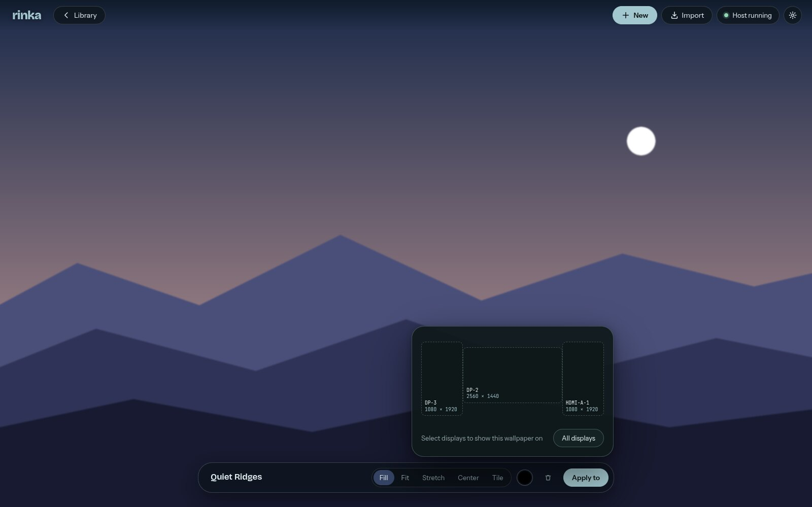

<p align="center"></p>

<h1 align="center">Rinka</h1>

<p align="center">
  Living wallpapers for Wayland: images, videos and converted Wallpaper Engine scenes,<br>
  drawn by a native Rust engine, with an editor that previews them through the same engine.
</p>

<p align="center"><a href="https://zaroc-dev.github.io/rinka/">Website</a> · <a href="#install">Install</a> · <a href="SPEC.md">Spec</a></p>



## What it does

- **Images, videos and solid colors** as wallpapers, placed with Fill, Fit,
  Stretch, Center or Tile. Videos decode through FFmpeg, loop, and follow
  their timestamps, including variable frame rates.
- **Wallpaper Engine import.** Reads workshop packages, converts image layers
  and translates effect shaders to WGSL. Every import comes with a report of
  what converted, what is approximated and what is missing; nothing is
  dropped silently.
- **One engine everywhere.** The renderer (Rust, wgpu) draws the wallpapers on
  Wayland layer-shell surfaces and, compiled to WebAssembly, the editor's
  WebGPU preview. Colors match byte-for-byte between the two.
- **Per-display assignment** from a to-scale map of your outputs. Wallpapers
  never take input or focus, and keep playing when the editor is closed.

Rinka is early. See [what works and what's next](#status).

## Install

Rinka is a Nix flake. You need a Wayland compositor with wlr-layer-shell (Niri
and Hyprland are the tested targets) and a Vulkan-capable GPU.

Try it:

```sh
nix run github:zaroc-dev/rinka
```

The editor starts the wallpaper host on its own. To have wallpapers come back
after a reboot, run the host at login with `--restore`, which reads the
assignments you made in the editor.

**Home Manager**

```nix
# flake.nix
inputs.rinka.url = "github:zaroc-dev/rinka";

# home.nix
imports = [ inputs.rinka.homeManagerModules.default ];
services.rinka.enable = true;
```

**Without Home Manager**, add `inputs.rinka.packages.${system}.default` (or
`overlays.default`) to your packages and start the host with your compositor,
for example in Niri:

```kdl
spawn-at-startup "rinka-host" "serve" "--restore"
```

### Notes

- The editor's preview needs hardware WebGPU. On NixOS, Chromium's GPU sandbox
  cannot see the Vulkan drivers in `/run/opengl-driver`, so Rinka disables
  that sandbox there (the page sandbox stays on). Set `RINKA_GPU_SANDBOX=1` to
  keep it.
- Wallpaper Engine import looks for your Steam workshop folder and the
  Wallpaper Engine install (for built-in effects) automatically. Rinka is not
  affiliated with Wallpaper Engine.
- Data lives in `~/.config/rinka`.

## Status

| Area | State |
| --- | --- |
| Solid colors, images, video (FFmpeg) | Works on Niri; Hyprland expected, not yet tested |
| Scene import: image layers, transforms, effect shaders | Works; 264 of 277 effect shaders translate |
| Particles, solid and composition layers, multi-buffer effects | Next, in the order measured scenes need them |
| Text, sound, SceneScript, 3D | Planned |
| Layer editor, project stacks | Planned |
| Windows | Engine builds; wallpaper playback not implemented |

Milestone notes with measurements: [M0](docs/m0-baseline.md),
[M1 images](docs/m1-images.md), [M2 video](docs/m2-video.md),
[M3 Wallpaper Engine](docs/m3-wallpaper-engine.md).

## Development

| Path | Contents |
| --- | --- |
| `crates/rinka-engine` | Project model, color conventions, renderer, scenes and effects. No platform code. |
| `crates/rinka-wasm` | The engine for the editor's WebGPU preview. |
| `crates/rinka-host` | Wallpaper host: Wayland layer-shell, control socket, FFmpeg video, import and thumbnail commands. |
| `crates/rinka-import` | Wallpaper Engine conversion: packages, textures, scenes, GLSL → WGSL, reports. |
| `app` | Electron + Preact editor. |
| `site` | The website, published to GitHub Pages. |

Everything builds in the dev shell:

```sh
nix develop
cargo test --workspace            # includes GPU readback tests
cargo build -p rinka-host
cd app && pnpm install && pnpm wasm && pnpm start
```

Useful host commands:

```sh
rinka-host serve [--socket PATH] [--restore [DIR]]
rinka-host import ITEM_DIR [--out DIR] [--allow-partial]   # prints the conversion report
rinka-host thumbnail < jobs.json
rinka-host preview DIR | --color '#1e6f73'
rinka-host video-timing FILE
rinka-host info
```

The control protocol (newline-delimited JSON over
`$XDG_RUNTIME_DIR/rinka/host.sock`) is documented in
`crates/rinka-host/src/protocol.rs`.

## License

GPL-3.0-or-later. See [LICENSE](LICENSE).
