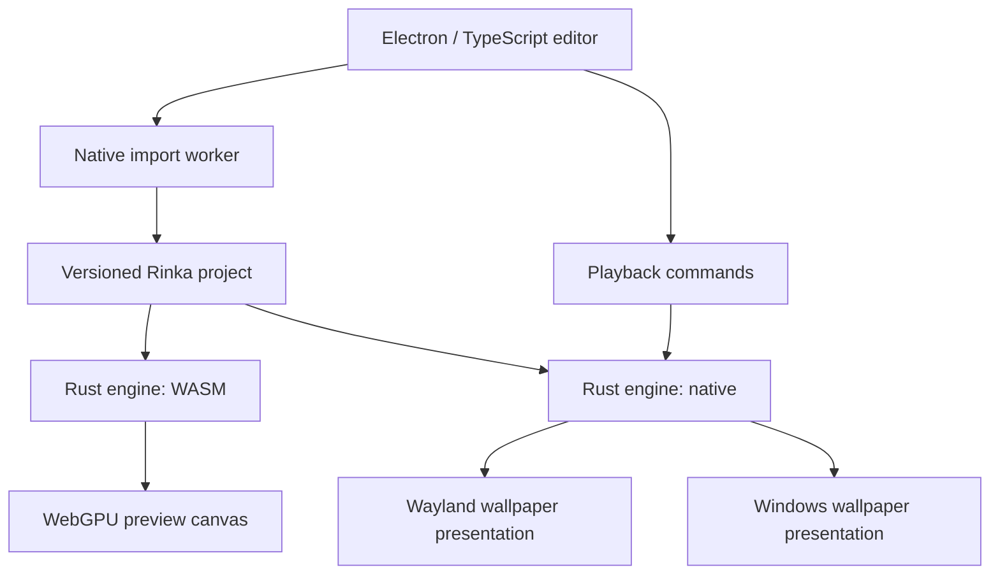

# Rinka: native wallpaper engine and editor

Status: initial specification, ready for feasibility experiments.
Date: 2026-10-14.
Name: Rinka. License: GPL-3.0-or-later.

This document records the agreed direction and proposes an implementation
sequence. Items marked open require evidence from prototypes before becoming
fixed architectural commitments.

## 1. Purpose

Build a wallpaper engine that produces correct, interactive scenes on native
Wayland desktops and Windows, with a useful editor and preview experience.

The primary motivation is dissatisfaction with existing Wallpaper Engine
implementations: scenes may load but produce incomplete effects or visibly
incorrect results. Rendering correctness is a release criterion, not a later
polish task.

Rinka owns its project format and runtime. Wallpaper Engine compatibility is
provided through an import/conversion step. Imported scenes become native Rinka
projects; they are not flattened into video as the normal import path.

This is a personal side project. Monetization is not a product requirement.

## 2. Agreed decisions

- One cross-platform desktop application, initially built with Electron and
  TypeScript. No separate Linux and Windows editor implementations.
- A separate Rust engine, shared by native playback and WASM preview builds.
- Live preview inside the editor is a first-class feature.
- Use wgpu as the planned shared graphics abstraction, with WGSL as the
  canonical initial shader representation. Validate basic native/WASM rendering
  in milestone 0 and imported shader compatibility in milestone 3.
- Build in this order: solid colors, images, FFmpeg video playback, then
  Wallpaper Engine scene import together with a project editor.
- Use FFmpeg for native video playback. The browser preview decoder is a host
  integration decision to validate during the video milestone.
- Native Linux playback targets Wayland, with Niri and Hyprland as the primary
  supported compositors.
- Windows support is part of the architecture from the beginning.
- COSMIC and KDE Plasma support may follow the primary targets.
- Native projects support layers and editing; Rinka is more than a wallpaper
  library or launcher for another engine.
- Import reports must identify unsupported behavior. Loading a scene while
  silently omitting effects does not qualify as successful compatibility.

## 3. Scope

### Initial product

- Display solid-color wallpapers.
- Display image wallpapers with explicit fit modes.
- Play video wallpapers through FFmpeg with looping and playback controls.
- Create, open, save and reopen native projects.
- Compose image layers with ordering, transforms, opacity and defined blending.
- Import a bounded, explicitly documented subset of Wallpaper Engine scene
  packages into editable native projects.
- Show live previews using the shared Rust engine compiled to WASM.
- Run native wallpaper playback on Niri and Hyprland.
- Provide Windows preview builds early and Windows wallpaper playback before
  declaring Linux/Windows support complete.
- Manage projects, output assignments and exposed wallpaper properties.
- Generate cached thumbnails and optional short preview clips through the
  engine; these supplement the live preview.

### Planned compatibility expansion

Multi-pass effects, particles, animation, audio response, supported SceneScript
behavior, deformation/puppet animation and 3D content are separate compatibility
increments. Their presence in a source package must always be detected, even
before the corresponding behavior can be converted.

No promise of arbitrary Workshop compatibility is made by the initial release.

### Outside the initial scope

- macOS, mobile and a public browser-hosted edition.
- GNOME integration.
- X11 playback.
- Wallpaper Engine executable/application wallpapers or web wallpaper hosting.
- A complete reproduction of Wallpaper Engine's editor.
- Steam subscription management, Workshop publishing or cloud accounts.
- Using Wine/Proton or the original Windows runtime for production playback.
- Multiple interchangeable GPU implementations or dynamically loaded renderer
  plugins before the shared engine is validated.

The original runtime can be used as a development reference.

## 4. Architecture

The app and engine are the two main architectural boundaries. Internal engine
modules may become workspace crates when that improves ownership, testing or
build isolation; creating many crates is not itself a requirement.

### Desktop app

The Electron app owns the library, project editor, import workflow, timeline,
property controls, playback configuration and application lifecycle.

The frontend sends scene edits and control messages. It does not implement a
parallel JavaScript particle system, shader renderer or animation evaluator.

### Shared engine

The Rust engine owns project loading, scene evaluation, simulation, rendering,
composition and asset lifetime management. Core modules must not depend on
Electron, Node, Win32 or Wayland.

Host adapters provide asset access, audio/input events, clocks and presentation.
Native and WASM builds consume the same project semantics and rendering logic.
Native and browser graphics backends still require independent verification.

### Native playback host

The planned deployment uses a native Rust helper process with a versioned local
control protocol. It owns wallpaper surfaces and can continue playback when the
editor closes. This is an engine host packaged with the same application.

Commands include load project, assign output, update properties, pause, resume,
query capabilities and report errors. High-frequency rendered frames do not
travel through Electron IPC.

The helper's exact transport and packaging are open. A library host remains
usable for tests and standalone preview tools.

## 5. Project model and layering

The project manifest is versioned and uses stable identifiers for assets,
layers, effects and exposed properties. A project directory is the initial
authoring representation; a packaged distribution format can follow.

The model must represent:

- Project metadata, canvas dimensions and color conventions.
- Asset references with explicit dependencies and content identities.
- Ordered layers and nested compositions.
- Transforms, visibility, opacity, blend modes and masks.
- Material parameters and ordered effect passes.
- Animation tracks and simulation settings.
- User-facing properties and bindings to scene values.
- Optional input, audio and script bindings as support is added.
- Import provenance and the conversion report.

Project assets use relative identifiers rather than absolute machine paths.
Saving and reopening a project must preserve authored and imported behavior.
GPU-specific pipeline caches are local cache data, not portable project assets.

Introduce the project model incrementally: color, image and video content first;
the layer/effect authoring interface arrives with scene import in milestone 3.
Early content milestones need basic library and playback controls, not the full
project editor.

Wallpaper layering has two levels: layers within a project, and an output stack
that may compose multiple project instances. Each project instance has its own
state and property overrides. The engine composites the final output into one
wallpaper surface per monitor; compositor surface ordering is not the project
layering mechanism.

Output-specific layouts and assignments belong to application configuration,
separate from portable project content.

## 6. Wallpaper Engine import

Import runs outside the preview render loop. The initial importer handles
metadata, package contents, supported texture formats, scene descriptions,
materials and the validated initial shader subset.

The conversion pipeline is:

1. Discover the package and classify its content.
2. Build a dependency inventory, including required built-in assets.
3. Decode assets and normalize scene values and coordinate conventions.
4. Translate supported scene objects, materials and animation data.
5. Process shader includes, macros and bindings; lower supported shaders into
   the canonical representation.
6. Validate the resulting project against the engine's capability profile.
7. Write the project and a structured conversion report.

Import must preserve a mapping from source objects to native objects so a
failure can identify the affected layer, effect, shader or dependency.

Conversion statuses are fully supported, partially supported and unsupported.
Fully supported describes the declared source features; visual compatibility
is tracked separately through the reference corpus.

Unsupported behavior blocks normal import. A user may explicitly choose a
partial import after seeing what will be lost. Import failures must not publish
a partially written project as a successful result.

Shader translation and script adaptation are semantic work. Renaming fields or
repackaging files does not establish correctness. Existing format research can
inform the importer, but existing renderers are not treated as a visual oracle.

## 7. Rendering and preview contract

### Shared graphics profile

Choose a documented baseline supported by both native wgpu and browser WebGPU.
An engine build reports its required features, limits and texture formats.
Projects are checked against that profile before playback.

The initial preview requires hardware-backed WebGPU. A WebGL fallback is not
part of the initial promise; it would need an explicitly reduced capability
profile and its own validation.

Import should normalize shader and texture features that can be converted
faithfully. Features that cannot be represented must produce actionable errors.

### Preview behavior

- Instantiate the same project used for native playback.
- Support pause/resume, property changes, viewport resizing and controlled input.
- Keep preview state independent of wallpaper playback.
- Apply edits incrementally when possible; preserve the current playhead unless
  the edit invalidates simulation state.
- Use fixed-step simulation where appropriate, with reproducible seeds.
- Implement seeking through reset/replay or state checkpoints. Stateful scenes
  cannot be assumed to render correctly from a timestamp alone.
- Stop unnecessary preview work when the editor is hidden or the preview is
  inactive; resume with an explicit clock policy.

Cached thumbnails and clips are keyed by project content, properties, engine
version and preview parameters. They must be invalidated when those inputs
change.

Browser preview and native playback must define matching alpha, color-space,
texture-sampling and timing behavior. Bit-identical output across GPUs is not
required; meaningful visual differences must be investigated.

### Video playback

Native video playback uses FFmpeg for demuxing and decoding. Decoded frames feed
the engine's video textures and composition path. Whether this uses library
bindings or a managed FFmpeg process remains an implementation decision.

Video timing follows presentation timestamps, including variable-frame-rate
content. Bound decode queues and define frame dropping/backpressure so decoding
cannot grow memory without limit or stall desktop presentation.

Support looping, pause/resume, seeking, fit modes and explicit mute behavior.
Define YUV-to-RGB conversion, color range, orientation and aspect-ratio handling.
Start with a documented SDR format/codec subset; expand hardware decoding and
format coverage after correctness is established.

The WASM preview receives media through a host decoder adapter. It must not
assume that native FFmpeg APIs are available inside the webview. Milestone 2
selects and validates the browser decoding path, comparing its output and timing
with native FFmpeg playback. The shared engine retains ownership of scene
composition and playback semantics.

## 8. Platform behavior

### Niri and Hyprland

Use background layer-shell surfaces with no reserved workspace area or keyboard
focus. Ordinary wallpapers must not intercept desktop input.

Support output discovery, removal/reconnection, resizing, fractional scaling,
rotation and explicit fit modes. Playback should suspend appropriately when an
output is powered off or the session is inactive.

Global pointer-dependent effects and visibility-based pausing require capability
detection and, where necessary, compositor-specific adapters. Basic layer-shell
support must not be advertised as proof that global input is available.

### Windows

Keep desktop placement, window handles, monitor/DPI events and Explorer recovery
inside the native presentation adapter. Recover wallpaper surfaces after shell
restarts and handle sleep/resume and device loss.

Windows 11 is the proposed initial validation environment. The exact minimum
Windows version remains open until milestone 0.

### Additional compositors

COSMIC and KDE Plasma are secondary targets. Supporting them must not introduce
platform branches into shared scene evaluation. They receive explicit acceptance
checks before being listed as supported.

## 9. Correctness and development workflow

Maintain complementary reference sets:

- Native test content for solid colors, image fitting and video timing/color.
- Small scenes created in the original editor to isolate blending, effects,
  particles, transforms, scripting and other behaviors.
- Representative real scenes with recorded features and expected output.

Each reproducible comparison records project revision, engine build, GPU/backend,
resolution, scale, time progression, seed, properties and input sequence.
Control these inputs in the original runtime where possible; document remaining
sources of nondeterminism.

Compare original output, native Rinka output and WASM preview output. Use image
diffs together with visual review; a single numerical threshold is insufficient
for animation, temporal artifacts or plausible-looking missing effects.

The engine must expose useful debugging output: layer isolation, intermediate
render targets, effect-pass inspection and shader compilation diagnostics.

Agent-assisted implementation should work in small, verified increments against
these references. Successful compilation or a plausible screenshot is not
sufficient evidence of compatibility.

## 10. Performance requirements

Initial priorities are correct output and avoiding architectural bottlenecks.
Numeric release budgets will be set from milestone 0 measurements.

Record frame time, startup/import time, shader compilation time, memory usage,
GPU utilization and idle behavior at common desktop resolutions. Measure native
playback separately from an open editor and its preview.

Normal rendering must avoid GPU-to-CPU frame readback and per-frame serialized
IPC. Asset transfers are cached; scene edits carry changes rather than complete
project reloads. Preview quality and FPS may be reduced independently of native
playback without changing scene semantics.

## 11. Milestones and acceptance gates

The first three milestones establish useful wallpaper playback before scene
reverse engineering and the project editor. Importing a Wallpaper Engine scene
is not a prerequisite for solid colors, images or videos.

### M0: solid colors and the presentation foundation

- Bootstrap one Electron app and the shared native/WASM Rust engine.
- Show a configurable solid color in the in-app WebGPU preview and native
  playback, with matching color conventions.
- Present actual background surfaces on Niri and Hyprland, with per-output
  assignment and no focus/input interference.
- Bring up a Windows native preview window to exercise the shared engine build.
- Establish the helper lifecycle, basic control API, output resizing and
  editor-close behavior.
- Record baseline GPU features, Electron version, driver behavior and resource
  usage on the developer's hardware.

Gate: solid colors work as wallpapers on both primary compositors and in native
and WASM previews; static content does not need a continuous busy render loop.

### M1: images

- Load image content through the project/asset model.
- Implement cover, contain, stretch, center and tile placement, with defined
  transparency and background-color behavior.
- Add image selection, minimal configuration persistence and library thumbnails.
- Exercise fractional scaling, rotated outputs and output reconnection.
- Complete Windows wallpaper presentation for color and image content.
- Compare image placement and color between browser preview and native playback.

Gate: saved image configurations reopen correctly; supported desktops pass
basic lifecycle checks and image output has no unexplained preview mismatch.

### M2: videos through FFmpeg

- Add native FFmpeg demux/decode integration and video textures.
- Implement timestamp-based scheduling, looping, pause/resume, seeking, mute and
  the existing image fit modes.
- Validate a small published SDR codec/container subset, including a
  variable-frame-rate sample.
- Select a browser preview decoding path and verify its color, frame placement
  and timing against native FFmpeg output.
- Bound decode queues, measure playback resource usage and define suspend/resume
  behavior. Hardware decoding follows as a measured optimization.

Gate: supported videos play and loop correctly on Linux and Windows; seeking
and pause/resume behave predictably; sustained playback has bounded memory.

### M3: Wallpaper Engine scene import and the project editor

- Add the project layer editor: create, reorder, transform, hide and configure
  layers, with immediate in-app preview updates.
- Create/save/reopen layered native projects, reusing color, image and video
  content from the earlier milestones.
- Import a declared Wallpaper Engine scene subset into editable native projects.
- Prove conversion of one representative scene with a nontrivial effect and
  inspect intermediate passes when output differs.
- Compare original output, native Rinka output and WASM preview output.
- Add structured conversion reports and explicit handling of unsupported source
  features; preserve source-to-native object mappings.
- Add project stacks for output-level composition.

Gate: authored and imported project round trips preserve behavior; validated
scenes have no unexplained visual mismatch; unsupported features are reported
rather than silently discarded. Revisit shader conversion or the graphics path
if the shared native/browser capability profile blocks faithful conversion.

### M4: expand compatibility from measured failures

Add multi-pass effects, particles and animation in the order justified by the
reference corpus. Track scripts, audio response, deformation and 3D as distinct
work streams. Each supported feature has isolated and representative references.

Gate: publish a feature-based compatibility matrix backed by evidence.

### M5: broader editing and desktop support

Expand timeline/effect authoring, interactive/audio workflows, project packaging
and secondary compositor adapters. Scope follows verified demand and the engine's
demonstrated capabilities.

## 12. Open decisions

- Exact Electron/wgpu versions and supported GPU capability profile.
- Shader conversion strategy and the initial source feature subset.
- Script execution strategy that preserves semantics in native and WASM builds;
  frontend JavaScript access is not automatically a SceneScript implementation.
- Project schema details, migration policy and eventual package format.
- Initial FFmpeg codec/container subset, integration method and browser preview
  decoding path; validate these during milestone 2.
- Native helper transport, distribution and autostart behavior.
- Preview quality controls and performance budgets.
- Windows minimum version and broader GPU/driver test coverage.

Resolve decisions at their relevant milestones through experiments and focused
design notes. Basic presentation comes first; video and imported shader decisions
are addressed when those capabilities are introduced.

## 13. Technical references

- [wgpu](https://github.com/gfx-rs/wgpu): native and WASM graphics paths.
- [Naga](https://github.com/gfx-rs/wgpu/blob/trunk/naga/README.md): shader input and
  output support; source shaders require normalization.
- [Electron process model](https://www.electronjs.org/docs/latest/tutorial/process-model).
- [Chromium WebGPU updates](https://developer.chrome.com/docs/web-platform/webgpu/news?hl=en).
- [Wallpaper Engine shader syntax](https://docs.wallpaperengine.io/en/scene/shader/syntax.html).
- [Wallpaper Engine shader variables](https://docs.wallpaperengine.io/en/scene/shader/variables.html).
- [SceneScript reference](https://docs.wallpaperengine.io/en/scene/scenescript/reference.html).
- [RePKG](https://github.com/notscuffed/repkg): package and texture format research.
- [Layer-shell protocol](https://wayland.app/protocols/wlr-layer-shell-unstable-v1).
- [Lively desktop integration discussion](https://github.com/rocksdanister/lively/discussions/3004).

References inform implementation; project claims require local validation.
